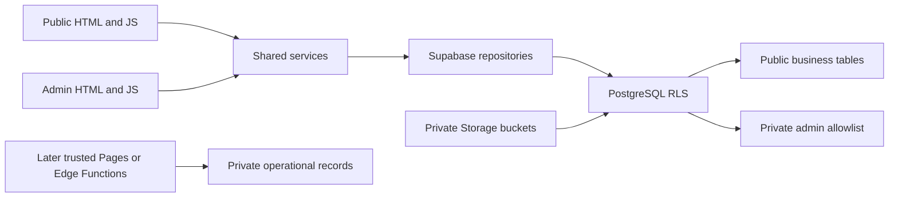

# Architecture and Phase 1 implementation plan

## Scope and plan

Phase 1 provides a runnable foundation: inspect the original documents; establish separate public/admin entry points; add safe shared modules and design tokens; model the relational entities; enforce database/storage access; provide isolated seeds and tests; document external setup. This section records that original work. Current behavior is described in [discovery architecture](discovery-architecture.md), [merchant architecture](merchant-architecture.md), [admin architecture](admin-architecture.md), [catalog architecture](catalog-architecture.md), [SEO/analytics architecture](seo-analytics-architecture.md) and [Phase 6 results](phase-6-report.md).

The original repository contained only AGENTS.md, MASTER_SPEC.md, LICENSE and a one-line README. No application code or existing database had to be migrated.

## Decisions

1. **Vanilla JavaScript with Vite.** Two HTML entry points share small DOM utilities and token-based CSS. No UI framework, icon library, webfont or carousel dependency is needed.
2. **Layered code.** Pages/components render text and manage UI state; services orchestrate; repositories access Supabase; domain modules will hold independently testable business rules. Import business logic into both public/admin flows rather than copying it.
3. **RLS is the authorization boundary.** Public reads always use the publishable key. A private, single-row allowlist maps one Auth UID to administration. No browser role assertion can grant privileges.
4. **Multi-city from the start.** Listings, localities, promotions and homepage sections carry city identifiers. Composite foreign keys reject cross-city assignments.
5. **Separate visibility concepts.** Publication, platform enablement, sponsorship, category-specific featured placement/rank and operating status are independent. A closure never unpublishes a business.
6. **Relational core.** Products, prices, schedules and ranks are typed relational records. JSONB is limited to category definitions/values and flexible offering details.
7. **Private operational records.** Checkout, import reports, catalog versions, audit metadata and analytics live outside the exposed API schema.
8. **Private media.** Reads follow listing/ad visibility. Uploads are restricted by admin UID, path, bucket type and size configuration.
9. **Money in minor units.** Non-negative constrained bigints fit safely in JS integers. Checkout will use authoritative prices in a trusted backend in Phase 3.
10. **Isolated tests.** PGlite executes the actual SQL without Docker or credentials. Auth/Storage system schemas are contract fixtures; a real Supabase stack remains a separate integration check.

## Boundaries

Public and admin bundles have separate entry points. Public SDK clients do not load or persist admin sessions. The initial unconfigured page does not load the SDK chunk. No Realtime subscription or unbounded catalog query is installed.

## Routing and SEO contract

Phase 1 routes were `/` and `/admin/`, plus a genuine static 404. Phase 2 adds `/rawatbhata`, `/rawatbhata/explore`, `/rawatbhata/search` and reusable `/:city/:category` routes, with URL-backed listing previews. These development pages remain excluded from indexing. The shared route parser is used by browser navigation, Vite and the Pages public HTML renderer.

Public route contracts:

- `/:city/:category` — reusable category page (Phase 2).
- `/:city/:category/:listing` — reusable merchant page using a stable UUID internally (Phase 3).
- `listing_slug_history` — stores previous slugs; the route service resolves current URLs and redirects old ones.

Phase 3 implements request-time merchant HTML through a lightweight Pages Function and the matching local Vite adapter. The shared renderer queries with public credentials under RLS, escapes content/bootstrap data, emits headings/business details, returns true 404s and validates canonical redirects. Publication requires no source-file creation or rebuild. Phase 6 adds shared full metadata, structured data, dynamic discovery HTML, sitemaps and analytics. See [merchant architecture](merchant-architecture.md) and [Phase 6 architecture](seo-analytics-architecture.md).

## Trust boundaries

Checkout and analytics have no public insert policies. Their trusted endpoints validate payload limits, independent rate limits, idempotency and eligible targets before writing. Checkout also verifies authoritative product availability/prices. An enquiry is only initiated or handed off; the schema has no sent/accepted/completed order state.

Phase 4 implements the separate admin dashboard, Auth verification, single-UID allowlist enforcement, bounded transactional writes and caller-scoped image uploads. Phase 5 adds lazy-loaded catalog management, bounded worker parsing and confirmed atomic imports. Phase 6 extends request-time HTML to discovery pages, shares metadata between server/browser, provides runtime-gated sitemaps/indexing, and adds private service-only event ingestion plus guarded admin aggregates. Initial public data is reused during hydration. A Cloudflare Pages preview uses the existing development backend; production is deliberately separate. See [Phase 6 architecture](seo-analytics-architecture.md).
